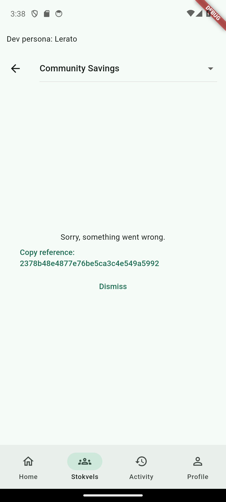

# Assignment 11.1: Real Data

RondiTrack Mobile uses the backend for Home, stokvel detail, activity, payout
order and close preview. The dev switcher signs in against the three seed
accounts. The selected stokvel membership determines available actions.

## Implementation

- `contract/openapi/v1.json` and `swagger_parser.yaml` pin the backend snapshot
  and scope of client generation. Generated Dart stays in `lib/core/data`.
- `lib/core/data/api_client.dart` owns the Dio instance, bearer header and
  privacy-filtered logs. Typed failures and screen messages are shared.
- The app entry point selects real repositories. Test containers can use
  `useApiProvider.overrideWithValue(false)` for all fakes.
- CI regenerates the client, detects new and modified files, and compares the
  committed backend snapshot using a selectable backend ref.

## Backend

Commits `7ec1735` and `b2652fc` publish the live contract,
distinguish close access for members and outsiders, and correct OpenAPI
metadata for numeric query parameters. [Backend PR #8](https://github.com/Damian-Salley/RondiTrack/pull/8)

## Repository swap

Commit `ee6a208` contains these files.

- `lib/main.dart`
- `lib/features/activity/activity_provider.dart`
- `lib/features/home/home_providers.dart`
- `lib/features/home/home_providers.g.dart`
- `lib/features/payouts/payout_providers.dart`
- `lib/features/stokvels/stokvel_providers.dart`
- `lib/features/stokvels/stokvel_providers.g.dart`

## Verification

- Formatting and strict analysis passed. The mobile regression suite passed
  147 tests, and the backend regression suite passed 109.
- Android dev and staging debug APKs and the prod ARM64 release APK built.
- [Green mobile CI](https://github.com/Damian-Salley/RondiTrack-Mobile/actions/runs/44532646984)
- [Red contract drift run](https://github.com/Damian-Salley/RondiTrack-Mobile/actions/runs/44532643338)
  [Screenshot](evidence/assignment-11.1/ci-red-contract.png)
- [Red mapper analysis run](https://github.com/Damian-Salley/RondiTrack-Mobile/actions/runs/44533042960)
  [Screenshot](evidence/assignment-11.1/ci-red-mapper.png)
  [Analyzer output](evidence/assignment-11.1/ci-red-mapper.txt)
- [Mobile test output](evidence/assignment-11.1/mobile-tests.txt)
- [Fresh seed live test](evidence/assignment-11.1/live-test.txt)
- [Local contract rename and analyzer diagnostic](evidence/assignment-11.1/contract-mutation.txt)
- [Three tests observed failing](evidence/assignment-11.1/test-mutations.txt).
  The deliberate changes reversed the 404 mapping, broke the Bearer scheme,
  and read paid cents in place of collected cents. The restored suite passed.
- [Evidence index and capture steps](evidence/assignment-11.1/README.md)

## Android dev screenshots

- [Lerato's real Home](evidence/assignment-11.1/lerato-home.png)
- [Inaccessible stokvel](evidence/assignment-11.1/not-found.png)
- [Family Savings close-preview 403](evidence/assignment-11.1/forbidden.png)
- [429 and the API's 60-second wait](evidence/assignment-11.1/rate-limited.png)

| Android dev build | Matching API log |
| --- | --- |
|  | `Unexpected server error. CorrelationId=2378b48e4877e76be5ca3c4e549a5992` |

[Original API log line](evidence/assignment-11.1/server-reference.txt)

## Backend CI

The backend's hosted API build, tests and image build passed. The existing web
frontend audit failed on the same workflow.
[Backend CI](https://github.com/Damian-Salley/RondiTrack/actions/runs/44532348679)

The cross-repo check uses the paired backend branch while `main` lacks the
snapshot. To test a different backend branch, dispatch CI using its branch
name as the `api_ref` input.
